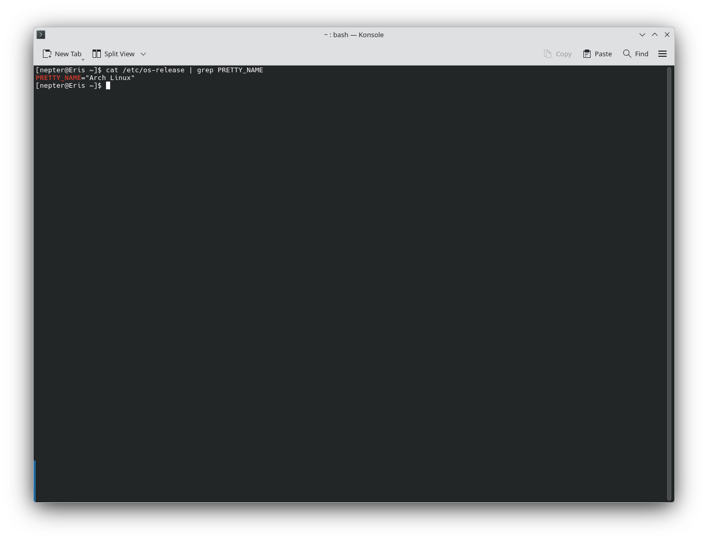
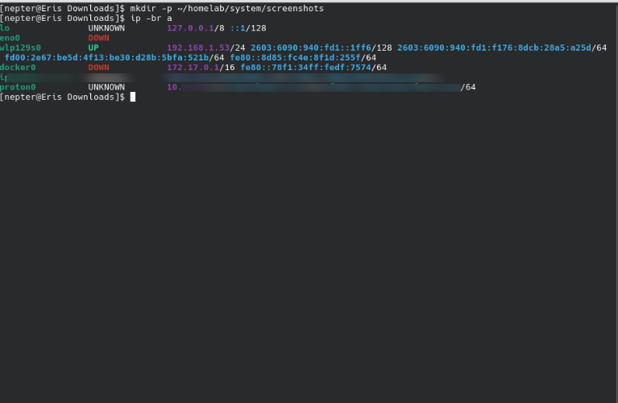
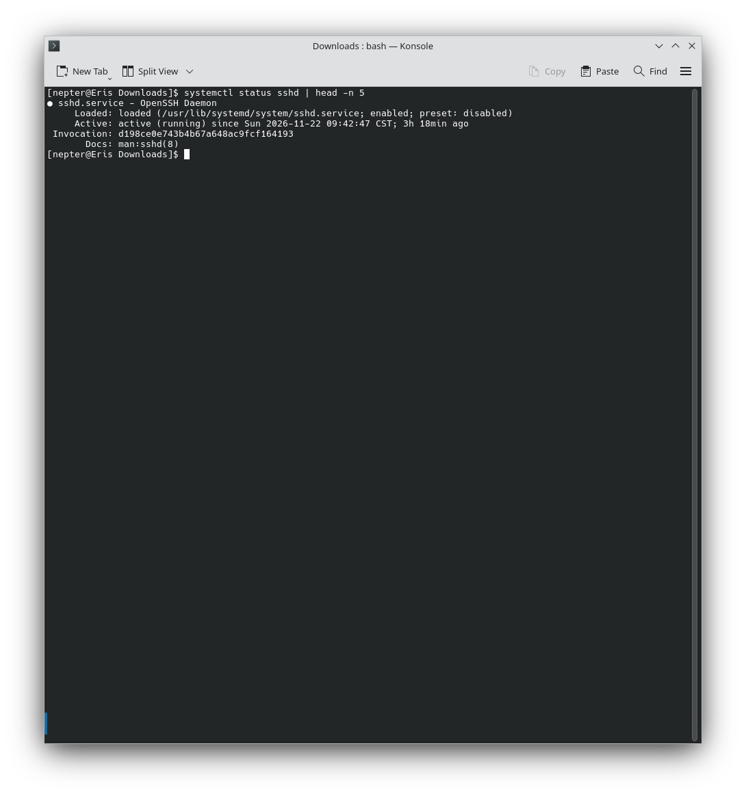
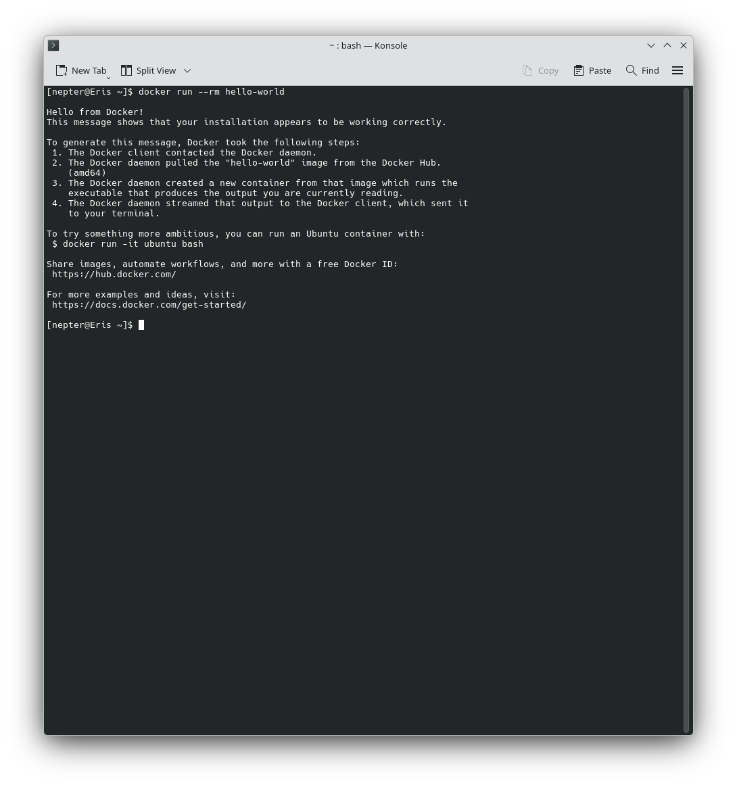

# Arch Linux Home Lab Server

## Objective
Deploy a headless Arch Linux server to host networking, containerized services, and security labs.

## Stack
- **OS:** Arch Linux
- **Remote Access:** OpenSSH (`sshd`)
- **Containerization:** Docker
- **Network:** `iproute2`

## Build Log
1. Installed base Arch Linux and configured KDE Plasma desktop environment.
2. Enabled OpenSSH daemon for secure remote administration.
3. Installed Docker Engine and configured user group permissions for rootless execution.
4. Verified network interfaces and baseline system configuration.

## Troubleshooting Log

### Issue: Docker Permission Denied
**Symptom:** Running `docker run hello-world` returned `permission denied while trying to connect to the Docker API`.
**Root Cause:** The user `nepter` was not added to the `docker` group, meaning the daemon socket rejected the request.
**Resolution:** Added user to the docker group via `sudo usermod -aG docker nepter` and refreshed the session using `su - nepter`.

### Issue: SSH Key Permission Denied
**Symptom:** `git push` failed with `Permission denied (publickey)`.
**Root Cause:** The local SSH keys were generated in the wrong directory and folder permissions were too open.
**Resolution:** Regenerated keys directly to `~/.ssh/id_ed25519`, enforced strict permissions (`chmod 700 ~/.ssh`, `chmod 600 ~/.ssh/id_ed25519`), and added the public key to GitHub.

## Evidence
- **System Info:** 
- **Network Interface:** 
- **SSH Service:** 
- **Docker Test:** 
